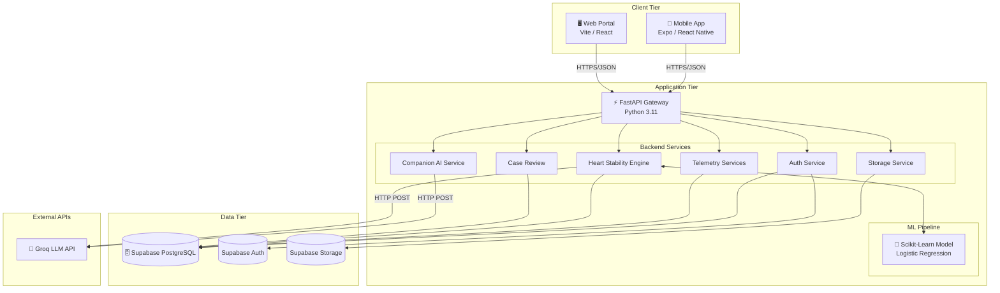

# HeartLink

## App Purpose
The application aims to monitor and track users' dietary and lifestyle habits and provide personalized recommendations, including food recipes and exercise routines, based on the user's Health Stability Score (HSS) to support cardiovascular health improvement.
HeartLink is designed to track and prevent heart disease from worsening, notice early warning signs, and remind users to get a timely in-person checkup from a nearby clinic.

> **Academic Capstone & Scope Note:**  
> HeartLink is an applied undergraduate Capstone Research Project (**Capstone 2 at Cebu Technological University - Main Campus / CTU Main**) developed with a scalable startup vision. The clinics listed in the app are part of a curated public directory to help users locate nearby healthcare facilities and encourage in-person medical checkups; HeartLink has no direct commercial affiliations with these clinics. Independent medical experts and faculty advisors assist the platform solely to audit and calibrate the safety and accuracy of recipes, exercises, and algorithmic scoring. HeartLink is a supportive wellness tool (not a diagnostic medical device) and encourages professional doctor consultations whenever warning indicators arise.

## 🏗️ System Architecture



### Components overview

* **Mobile App** (`HeartLink-mobile/`): for patients, to log and track daily health data. Expo / React Native.
* **Web Portal** (`HeartLink-web/`): for medical experts and administrators: case review, content and user management. (The Model Check page, which replaces Calibration History, is being built in HL-058.) Vite / React.
* **Backend API** (`backend/`): Python 3.11 / FastAPI. Business logic, login and permissions, health data, case review, and the Heart Stability Score (HSS) engine.
* **Database & Services**: Supabase (PostgreSQL, Auth, Storage). Groq's LLM API powers the dashboard insights and the optional Companion AI.

**Only the backend talks to Supabase.** The mobile app and web portal call the backend; direct table access with the public Supabase key is blocked (migration 020).

### How the Heart Stability Score (HSS) is calculated
* **At onboarding:** a scikit-learn **Logistic Regression** model (`backend/app/ml/heartlink_model.pkl`) reads 37 questionnaire and diet inputs and predicts the chance of "higher risk". The score is `HSS = (1 − probability) × 99 + 1`.
* **After that:** logged blood pressure and heart rate are scored with fixed guideline rules, and daily meals, exercise and sleep add or subtract lifestyle points.
* **Levels:** 80–100 Stable · 60–79 Moderate · 50–59 Elevated Risk · 1–49 Critical.

## 👥 User Roles & Access

| Role | Where | What they do |
|------|-------|--------------|
| **Patient** | Mobile app | Log vitals, meals, exercise and sleep; see their HSS and recommendations; find nearby clinics. |
| **Medical Expert: Cardiologist** | Web portal | Owns each case review: risk level, reasons, confidence and checkup flag. |
| **Medical Expert: Dietitian** | Web portal | Checks the recipes recommended for a case. |
| **Medical Expert: Physical Therapist** | Web portal | Checks the exercises recommended for a case. |
| **Admin** | Web portal | Users, content (recipes, exercises), clinics, broadcasts, feedback; follows the review queue and draws the weekly sample. |
| **Super Admin** | Web portal | Everything an Admin can do, plus creating staff accounts (and verifying clinicians once HL-058 lands). |

New staff get a one-time temporary password and must set their own on first login.

## 📁 Repository Structure

```plaintext
CAPSTONE-2/
├── backend/               # FastAPI server, HSS engine, case review, database migrations (backend/supabase)
├── HeartLink-web/         # Web admin & expert portal
├── HeartLink-mobile/      # Patient mobile app
├── landing/               # Project landing page
├── documentation/         # Database schema, user flows, formulas, and planning docs
├── docker-compose.yml     # Local development with Docker (see DOCKER.md)
└── DOCKER.md              # Team guide: run the backend + portal with Docker
```

## 🌐 Deployments & Environments

| Component | Provider | Branch | URL | Status |
|-----------|----------|--------|-----|--------|
| **Backend API** | Railway | `main` | `https://heartlink-api-production-46db.up.railway.app` | 🟢 Active |
| **Web Portal** | Vercel | `main` | `https://heartlink-admin-six.vercel.app` | 🟢 Active |
| **Backend API (standby)** | Render | not connected | `https://heartlink-staging.onrender.com` | 🟡 Suspended |
| **Database & Storage** | Supabase | shared | Managed service | 🟢 Active |

**Branches:** work happens on `staging`; `main` is what Railway and Vercel deploy (the live site). Staging and live share **one Supabase database**, so database changes reach the live app right away. See [backend/supabase/README.md](backend/supabase/README.md) for how to change the database safely.

## ⚙️ Prerequisites

* **Python 3.11** (backend)
* **Node.js 20+** and `npm` (web portal and mobile app)
* **Expo Go** on your phone, or an Android/iOS emulator
* Or **Docker Desktop** to run the backend and portal without installing Python/Node for them (see below)

## 🚀 Local Development Setup

### Option A: Docker (recommended for the team)
Runs the backend and web portal with one command. Full guide: **[DOCKER.md](DOCKER.md)**.
```bash
cp backend/.env.example backend/.env   # then fill in the values (ask the project lead)
docker compose up --build
```
Backend: http://localhost:8000 · Portal: http://localhost:5173 · Mobile app: see step 3 below.

### Option B: Run each part yourself

**1. Backend API (FastAPI)**
```bash
cd backend
pip install -r requirements.txt
cp .env.example .env   # then fill in the values
uvicorn app.main:app --reload --host 0.0.0.0 --port 8000
```
Runs on http://localhost:8000. `--host 0.0.0.0` lets your phone reach it over Wi-Fi.

**2. Web Admin Portal (React/Vite)**
```bash
cd HeartLink-web
npm install
cp .env.example .env
npm run dev
```
Runs on http://localhost:5173 and forwards `/api` calls to the backend.

**3. Mobile App (React Native/Expo)**
```bash
cd HeartLink-mobile
npm install
cp .env.example .env   # set EXPO_PUBLIC_API_URL=http://<your computer's Wi-Fi IP>:8000
npx expo start
```
Scan the QR code with Expo Go (same Wi-Fi as the computer), or press `a` / `i` for an emulator.

## 📚 More documentation
* [DOCKER.md](DOCKER.md): Docker setup for the team
* [backend/README.md](backend/README.md) · [HeartLink-web/README.md](HeartLink-web/README.md) · [HeartLink-mobile/README.md](HeartLink-mobile/README.md)
* [backend/supabase/README.md](backend/supabase/README.md): making database changes
* [documentation/README.md](documentation/README.md): database schema and access rules
* [documentation/USER_FLOWS.md](documentation/USER_FLOWS.md) · [documentation/IPO_MODELS.md](documentation/IPO_MODELS.md) · [documentation/COMPUTATIONS_AND_FORMULAS.md](documentation/COMPUTATIONS_AND_FORMULAS.md)
