# HeartLink — System User Flows & Lifecycle Guide

This document outlines the step-by-step technical and user journeys for the primary features across the HeartLink mobile application and web portal.

*Last updated 2026-11-12: setup with the PAR-Q+ and the heart questions, Heart risk and the habits score (they replaced the Health Stability Score), the Dashboard swipe card and Today's note, the AI summary on Trends, the exercise safety pauses, the emergency symptoms, the recipe sodium note, and the Visit summary. Streaks were removed. Section 14 (Case review and Model Check on the web
portal) was added for HL-153.*

## 1. Application Launch & Routing (Splash Screen)

The splash screen is the very first thing you see when you open the HeartLink app. It acts like a "traffic cop," checking who you are and directing you to the right place.

### Scenario
**"A patient opens the HeartLink app on their phone."**

When the patient taps the app icon, the app needs to quickly figure out:
1. Is this person already logged in?
2. If they are logged in, have they finished setting up their health profile?

Depending on the answers, the app decides whether to show them the login screen, the setup questionnaire, or their main dashboard.

### Logic Used
*   **Safety Net (Timeout):** The app gives the internet connection exactly 4 seconds to figure out who the user is. If the connection is too slow and takes longer than 4 seconds, the app will stop waiting and move forward. This ensures the user is never stuck on an endless loading screen.
*   **The 3 Paths (Routing):**
    1.  *Unauthenticated User:* If the app doesn't recognize the user (they aren't logged in), it sends them to the **Onboarding** screen to log in or create an account.
    2.  *New User:* If the user is logged in but hasn't finished answering their initial health questions, it sends them directly to the **Baseline Setup**.
    3.  *Returning User:* If the user is logged in and all setup is complete, they go straight to their **Dashboard**.

### 1.1 Technical Loading Flow
This diagram shows how the app juggles the logo animation and checking the user's memory at the same time:

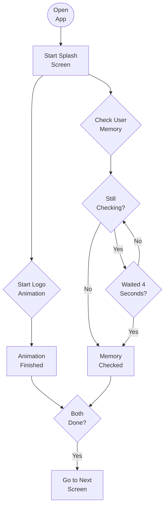

### 1.2 Routing Logic
This diagram shows how the app decides exactly where to send the user after the loading is done:

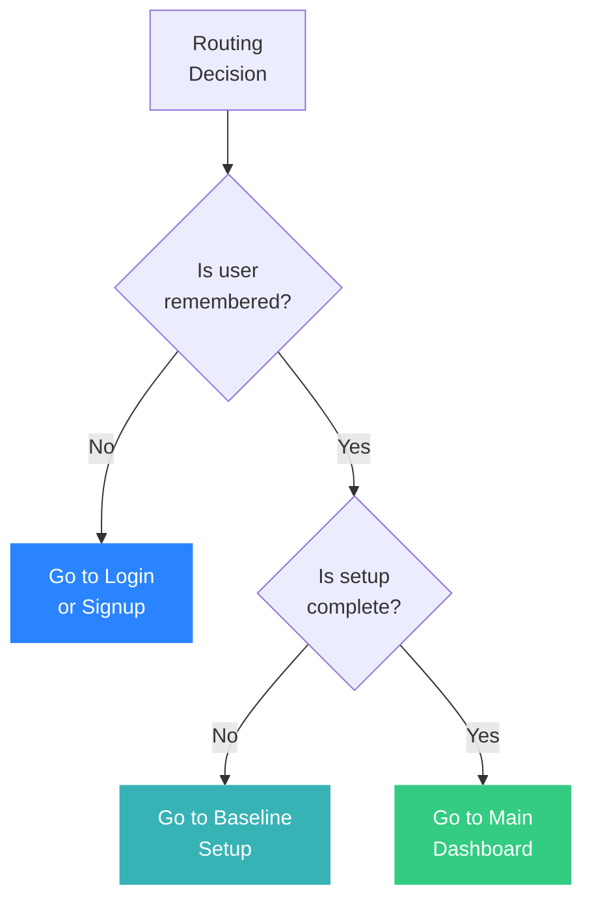

## 2. Account Registration & Login

This flow covers how a new patient creates an account and how returning patients log in.

### Scenario
**"A new patient wants to start using HeartLink, and a returning patient wants to check their dashboard."**

If it's a new patient, they need to provide their email, phone number, and a strong password. Because health data is highly sensitive, the app requires them to verify their phone number via a texted code (OTP) to prove it's really them.
If it's a returning patient, they simply log in using either their email or phone number and their password.

### Logic Used
*   **Smart Login Identifier:** The login screen is smart enough to accept *either* an email address or a phone number in the exact same box. It automatically detects which one the user typed.
*   **Password Security:** When creating an account, the app checks the password in real-time to make sure it has at least 8 characters, upper/lowercase letters, and a number.
*   **Verification (OTP):** To stop fake accounts, new users aren't immediately logged in. Instead, their details are held in a waiting state while a verification code is texted to them.
*   **Duplicate Checks:** If a user tries to register with an email or phone number that already belongs to an active account, the app will stop them and suggest they log in instead.

### 2.1 Registration Flow
This chart explains what happens behind the scenes when a user signs up:

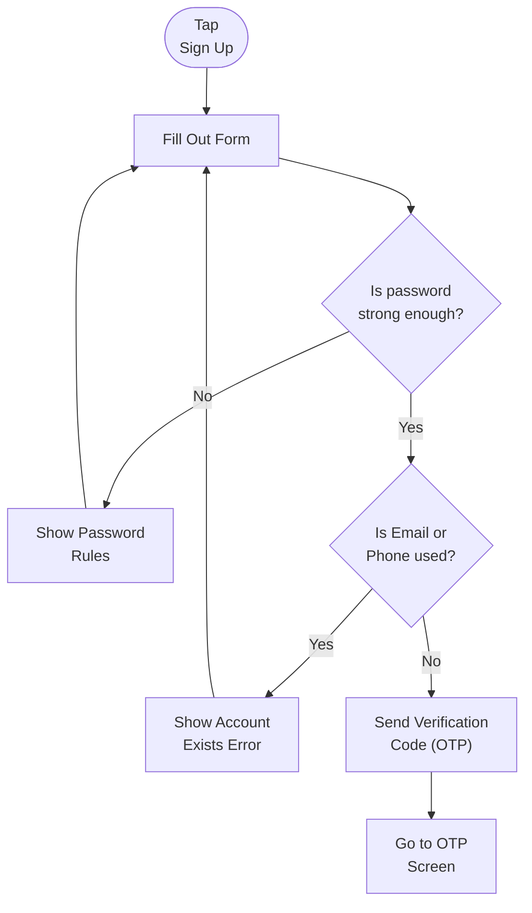

### 2.2 Login Flow
This chart explains how the app logs a returning user back in:

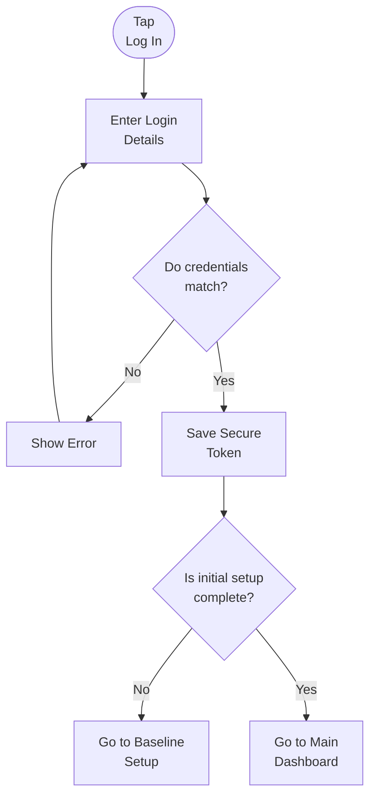

## 3. Baseline Setup Questionnaire

This flow describes what happens right after a new patient signs up. HeartLink asks a few questions once, so it can show a starting picture of the patient's heart health and offer only exercises that are safe for them.

### Scenario
**"A new user finishes signing up and sets up their profile."**

The user first reads "Before we start": what HeartLink is (a wellness tool, not a diagnosis) and when to get help right away. A set-up map then shows four short parts. The user answers one question per screen, sees a recap after each part, and then answers the exercise safety check (the PAR-Q+). At the end they see two numbers: their **heart health habits score** and their **estimated 10-year heart risk**. They can log a first blood pressure reading, choose reminders, and see what day one looks like before reaching the Dashboard.

### Logic Used
*   **Four parts, one question per screen:**
    1.  *About you:* name, birthday, sex, height and weight.
    2.  *Movement:* hard exercise, moderate activity, walking or biking, and sitting time.
    3.  *Habits:* sleep, smoking, alcohol, and three heart questions: blood pressure medicine, diabetes, and cholesterol medicine.
    4.  *Food:* portions, fruit and vegetables, fried and salty food, allergies and diet.
*   **Finish later:** The set-up map remembers which parts are done, so the user can stop and carry on later. After each part, a recap shows their answers with Edit links.
*   **Exercise safety check (PAR-Q+):** The whole PAR-Q+ is answered inside the app. The server works out the result, which decides **which exercises are offered, never the score**. It is a screening, not a diagnosis.
*   **Starting numbers:** The answers are sent to the server once. It works out the starting **habits score** (out of 100, higher is better, based on the AHA's Life's Essential 8) and an **estimated heart risk**: the chance of a heart attack or stroke in the next 10 years (AHA PREVENT, lower is better). It stays "estimated" until the patient adds cholesterol and kidney lab results. People under 30 see "Heart risk estimates start at age 30".
*   **First reading:** The user can log a first blood pressure reading on the normal check-in screen, so the emergency checks run exactly as they do everywhere else. "I don't have a monitor right now" skips it.
*   **Status Update:** The account is marked as set up, so these questions are not shown again. Answers can be changed later in Settings.

### 3.1 Setup Flow
This diagram shows the journey from the first screen to the Dashboard:

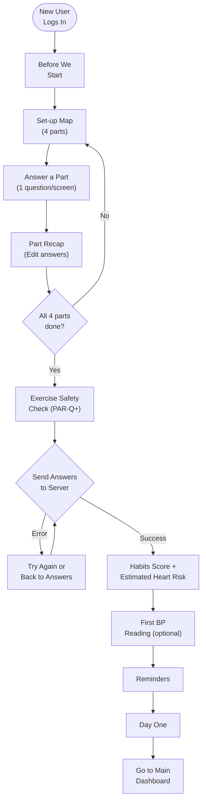

## 4. Main Dashboard Experience

The dashboard is the central hub of the HeartLink app. This is the main screen the patient uses every day to log check-ins, see their numbers and get suggestions.

### Scenario
**"A patient opens the app in the morning to check their status, log their blood pressure, and see what meals or exercises are suggested for them today."**

At the top is a card the patient can swipe through: their **heart health habits** score, today's habits, and their **10-year heart risk**. Below it are today's check-ins (blood pressure, meals, movement, sleep), "Today's note", their blood pressure for the week, meals and exercises picked for them, and Care & Support (the Visit summary and nearby clinics).

### Logic Used
*   **Swipe Card:** Three pages (swipe or tap the dots):
    1.  *Heart health habits:* the habits score out of 100 and its level. Tapping the i shows every habit's points.
    2.  *Today's habits:* how today's blood pressure, movement, sleep and food are going.
    3.  *Heart risk:* the 10-year chance of a heart attack or stroke, with its band (Low, Borderline, Intermediate or High) and an "Estimated" tag until lab results are added. Intermediate and High show a gentle "discuss this with your doctor at your next checkup" note. It is never an emergency alarm.
*   **Health Alert Popup:** If the server has an active health alert the patient hasn't dismissed, a "Health Alert" popup opens with a button to find a healthcare facility.
*   **Today's Note:** One line on what just changed the score, with a step to take when there is one. It is written by rules, not AI. After an emergency-level reading it turns red with "Call 911".
*   **Offline Mode:** Without internet, the dashboard still shows the last known data. Logs are saved on the phone and uploaded when the connection returns.
*   **First-Time Tour:** The first time, a short tour explains each section: habits and heart risk, today's check-ins, today's note, blood pressure this week, picked for you, and Care & Support.
*   **Weekly Visit Summary Banner:** Once a week, a banner says "Your visit summary is ready". Opening the Visit summary hides it for that week.
*   **No Streaks:** Streaks were removed (2026-11-12). The app looks at what was logged, not at unbroken runs of days.
*   **Smart Routing:** The dashboard is a launchpad. A recipe opens its details, an exercise opens its guide, the blood pressure card opens Trends, and Care & Support opens the Visit summary or the clinic locator.

### 4.1 Dashboard Loading Flow
This diagram shows what happens behind the scenes when the dashboard screen opens:

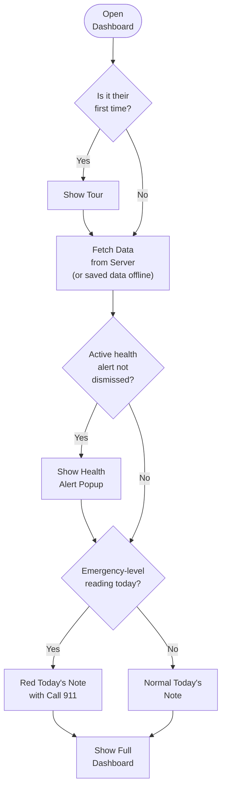

### 4.2 Dashboard Interactions
This diagram explains every major action a patient can take from the main dashboard screen:

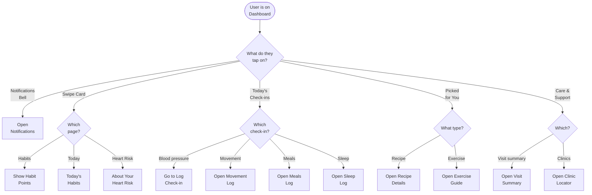

## 5. Today's Check-ins (Daily Missions)

Every day, the dashboard shows four check-ins: Blood pressure (with the medicine answer), Movement, Meals, and Sleep.

### Scenario
**"A patient logs their daily habits directly from the dashboard."**

When the patient taps a mission, the app smartly determines the fastest way for them to log that specific type of data. Sleep pops up a quick slider, meals offer barcode scanning, and vitals open a detailed symptoms page.

### Logic Used
*   **Mission Status:** The dashboard instantly tells the user what's due (e.g. "Morning check due today") and updates to show progress (e.g. "120/80 mmHg" or "400 mg used") immediately after logging.
*   **Contextual Popups:** Instead of sending the user to separate screens for everything, Sleep and Movement can be logged via quick, frictionless popups without leaving the dashboard.
*   **Advanced Tracking:** For complex tasks like logging meals, a popup provides three powerful options: Scanning a barcode using the camera, searching the nutrition database, or estimating manually.

### 5.1 Vitals & Sleep Flow
This flowchart shows the straightforward path for tracking daily vitals and sleep habits:

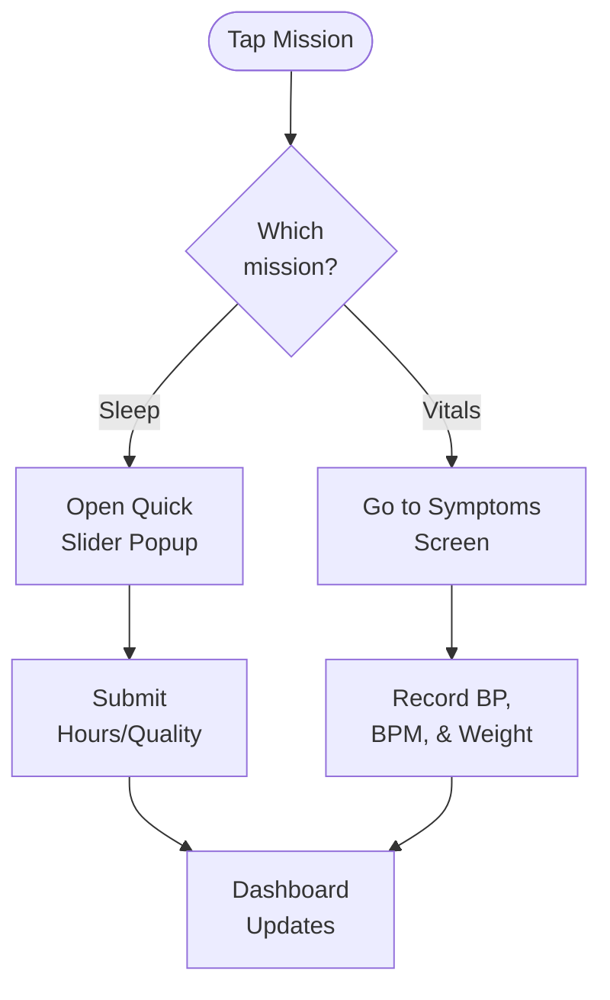

### 5.2 Meals & Movement Flow
Logging food and exercise has multiple options. Here is how the app handles them:

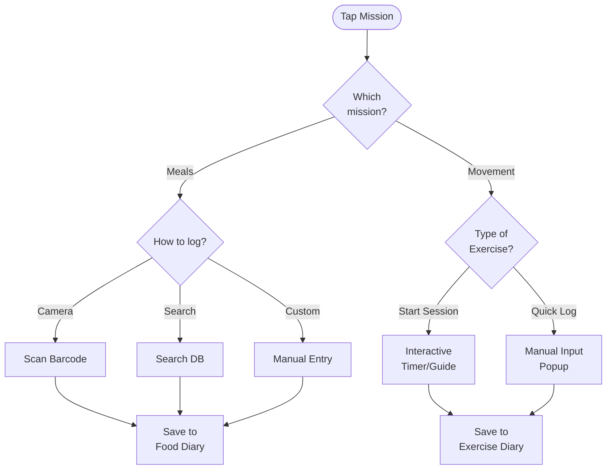

## 6. Trends & Analytics Experience

The Trends tab shows patients how their numbers change over time, drawn only from what they logged.

### Scenario
**"A patient wants to see if their blood pressure has improved over the last 14 days."**

The patient opens the Trends tab, picks "Blood pressure" and the 14-day period. The chart updates, and an AI summary explains in plain words how the period went. Best day and saltiest day are shown under the chart.

### Logic Used
*   **One Measure at a Time:** Heart risk, Habits score, Blood pressure, Pulse or Sodium. A day with nothing logged is left empty on the chart; nothing is filled in.
*   **Periods:** 7, 14 and 30 days are free. 90 days and 1 year are Premium.
*   **AI Summary:** A short summary of the period to help the patient understand their progress and habits. It is not coaching and not medical advice. The server works out the facts from the patient's own logs; the AI only rewords them, and its text is checked (no new numbers, no medical words, no advice, no risk). If the check fails, the plain sentences show instead.
*   **Highlights:** Best day (highest habits score) and saltiest day, once there are enough days with a habits score. Streaks were removed.
*   **Share:** The share button makes a short Trends PDF for the 7, 14 or 30-day period. For 90 days or 1 year it opens the Visit summary instead (see section 13).

### 6.1 Trends Screen Flow
This flowchart shows how the patient navigates and interacts with their data on the Trends screen:

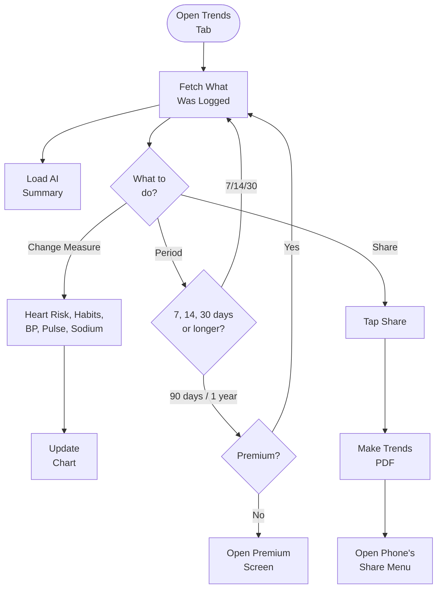

## 7. Explore & Discovery Experience

The Explore tab serves as the patient's discovery engine. This is where they can find new heart-healthy recipes, discover recommended exercise routines, and access their saved favorites.

### Scenario
**"A patient is looking for a new cardio workout or a low-sodium dinner recipe."**

The patient opens the Explore tab and uses the search bar at the top to type what they want (e.g., "salad"). The app instantly highlights matching results. They can use the "Recipes" or "Exercise" pills to filter down their choices, or look at their "Saved" list for meals they've bookmarked before.

### Logic Used
*   **Live Search Highlighting:** As the user types into the search bar, the app instantly filters the list and visually highlights the matching letters in the search results so they know exactly why a result appeared.
*   **Smart Categorization:** The main "All" view shows a curated mix of the top 5 recipes and top 3 exercises recommended for them today.
*   **Category Filtering:** Tapping the pills (All, Recipes, Exercise, Saved) dynamically switches the entire layout of the screen. Recipes are displayed in a visually heavy grid format, while exercises are shown in a clean list format.

### 7.1 Explore Tab Flow
This flowchart maps out how the discovery engine works:

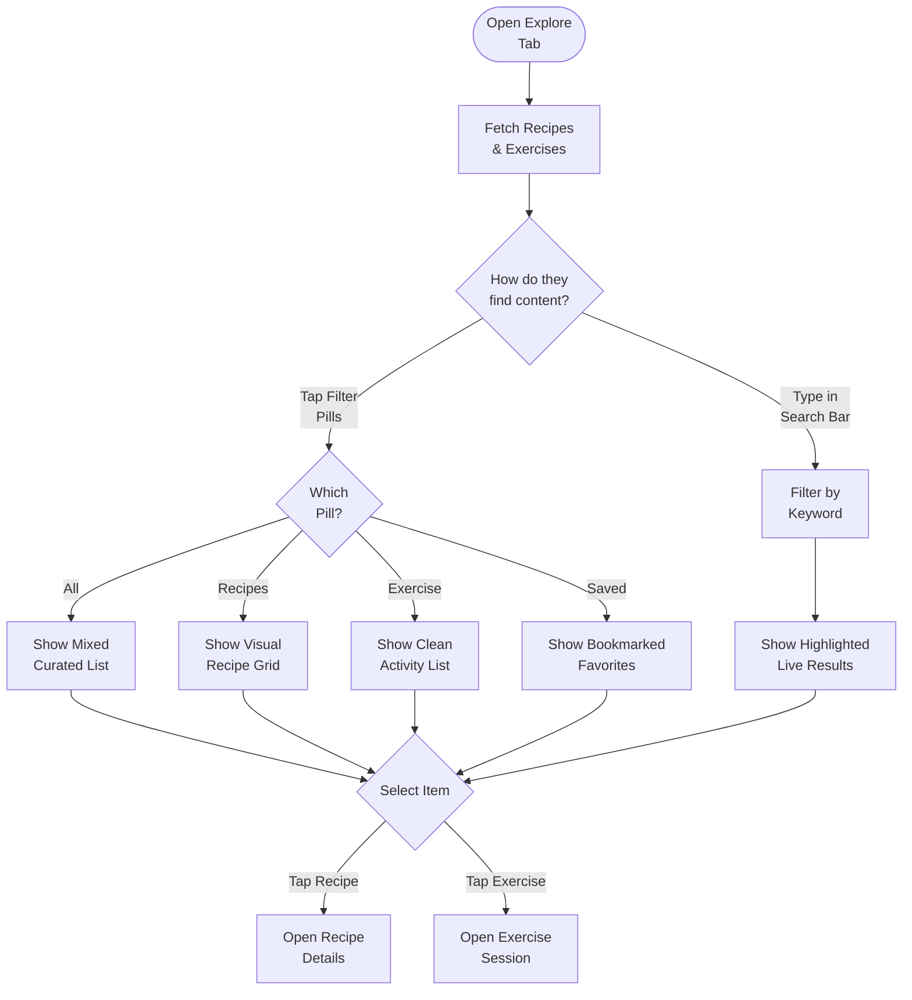

## 8. Recipe Details & Food Logging Flow

When a user taps on a recipe from the Explore tab or the Dashboard, they are brought to the Recipe Details screen. This page acts as both a cookbook and a nutrition calculator.

### Scenario
**"A patient finds a recipe, adjusts the portion size because they are cooking for two, and then logs the meal to their daily diary."**

The patient opens a recipe and sees the ingredients list and step-by-step instructions. They use the '+' button to increase the servings. The app instantly updates the nutrition macros. Because they doubled the portion, a "High in sodium" note explains that this amount is more than half of a 1,500 mg daily sodium limit. They adjust it back down and tap "Log This Meal".

### Logic Used
*   **Dynamic Servings:** The app multiplies the calories, sodium, fiber, and saturated fat in real-time as the user adjusts the servings counter.
*   **Sodium Note:** The app checks the sodium for the chosen servings. Over 800 mg shows "High in sodium" (more than half of the 1,500 mg daily limit); over 400 mg shows a milder note. No food is called forbidden: the note explains the amount and how lighter meals later can balance the day. Allergy and diet warnings stay separate and strong.
*   **Offline Meal Logging:** If the user is in the kitchen with bad internet and logs the meal, the app smartly saves it locally ("queued for sync") and uploads it later when a connection is restored.

### 8.1 Recipe Interaction Flow
This flowchart maps out how a user interacts with a recipe and ultimately logs it:

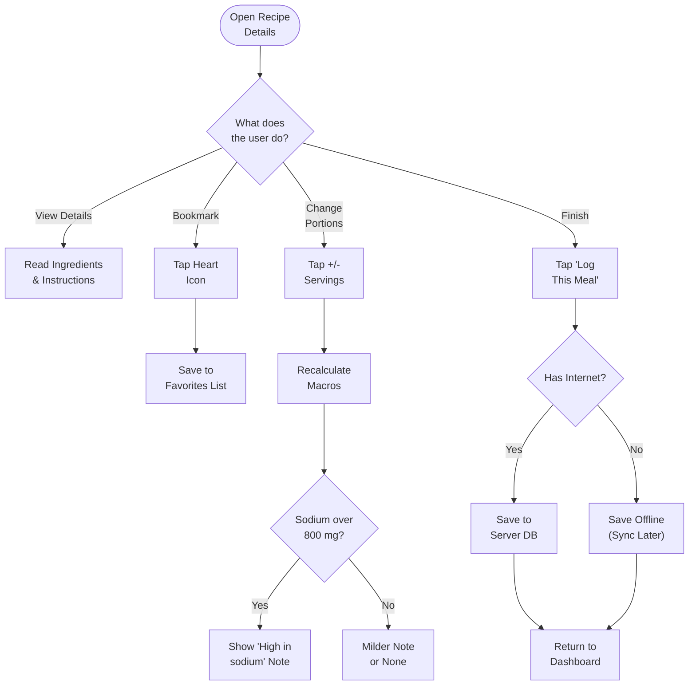

## 9. Exercise Session Flow

The HeartLink app doesn't just list workouts; it actively guides patients through them while prioritizing cardiac safety. This flow covers everything from viewing the workout instructions to the live timer and the post-workout safety checks.

### Scenario
**"A patient decides to start a 15-minute cardio routine but feels slight chest tightness halfway through and stops."**

The patient opens the Cardio workout and reads the guide. They tap "Start Exercise" and a 3-second countdown begins. The live session timer starts. Halfway through, they tap the 'X' button because they feel unwell. The app immediately asks if they stopped because they were tired or because of symptoms. They select symptoms, and the app instantly aborts the workout and rushes them to the Symptom Logger to record the chest tightness.

### Logic Used
*   **Safety First (Workout Pause):** The exercise safety check (PAR-Q+) decides, never the score. A workout is paused after a recent severe symptom, an emergency-level blood pressure reading, or a "Locked" or "Delayed" safety check result. "Eligible with caution" allows beginner exercises only. If the check hasn't been done, tapping "Start" opens it first. Breathing exercises always stay open.
*   **Adaptive Player:** The live workout player adapts to the type of exercise. It loads a specialized screen depending on whether it's Breathing, Stretching, Cardio, or General Activity.
*   **Short Session Check:** If the user stops a workout in under 30 seconds, the app asks if they want to discard it or save it anyway, preventing accidental logs.
*   **Clinical Safety Net:** Every time a user finishes or stops an exercise, they must answer a post-workout assessment ("I feel OK" vs. "I have symptoms"). Logging symptoms here automatically tags them as exercise-induced for their doctor to review.

### 9.1 Exercise Session State Machine
This flowchart details the exact sequence of states a patient moves through during an active exercise session, including all safety exits:

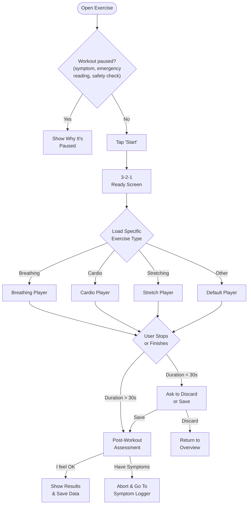

## 10. Symptom & Vitals Logger (Daily Check-in)

The daily check-in is the core data collection tool of HeartLink. It captures blood pressure, heart rate, weight, medication adherence, and any acute symptoms. 

### Scenario
**"A patient wakes up, takes their blood pressure, and logs it into the app."**

The patient taps the '+' button to log their vitals. They enter their systolic (top) and diastolic (bottom) numbers, their pulse, and select that they took their meds. They use the slider to record mild fatigue (Level 3). The app validates that the top number is higher than the bottom number and saves the log.

### Logic Used
*   **Medical Validation:** The app performs sanity checks on the inputs: Systolic must be higher than Diastolic by at least 15 points. Weight cannot be absurdly low or high. If values are backwards, it throws an error.
*   **Emergency Triggers:** If it detects an acute Hypertensive Crisis (180 or higher top number, or 120 or higher bottom number) or Severe Hypotension (under 90 top, or under 60 bottom), it immediately shows the emergency guidance advising them to seek medical care. The same happens for chest discomfort rated 7 or more, shortness of breath while resting, or fainting or nearly fainting.
*   **Interactive Severity Slider:** When a symptom is selected, an interactive draggable slider appears to rate the pain/severity from 1 to 10, changing color from green to red.

### 10.1 Symptom Logger Flow

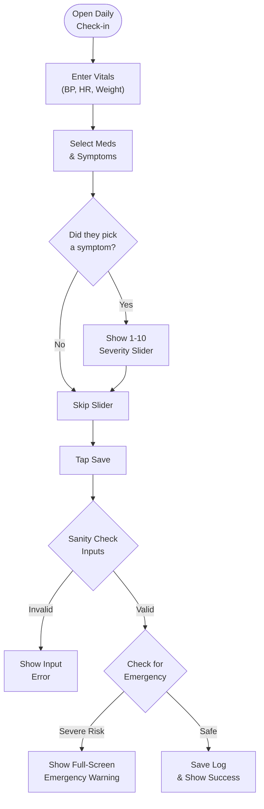

## 11. Barcode Food Scanner Flow

To make logging sodium and calories easier, patients can simply scan the barcode on any packaged food using their phone's camera.

### Scenario
**"A patient is at the grocery store and wants to check the sodium content of a soup can before buying it."**

The patient taps "Scan meal". The camera opens with a laser animation. They center the barcode. The app instantly looks up the item from a global database and returns the nutrition facts, automatically highlighting the sodium amount.

### Logic Used
*   **Global Database Lookup:** Scanned barcodes are instantly sent to the OpenFoodFacts API (`world.openfoodfacts.org`).
*   **Serving Size Normalization:** The app smartly parses the API response to find the "per serving" metrics. If "per serving" isn't available, it defaults to calculating the macros based on 100g and labels it appropriately.
*   **Fallback Mechanism:** If the scanner fails, times out, or the barcode is unlisted, an alert pops up offering the patient to "Estimate" the meal manually or try typing the barcode numbers themselves.

### 11.1 Barcode Scanner Flow

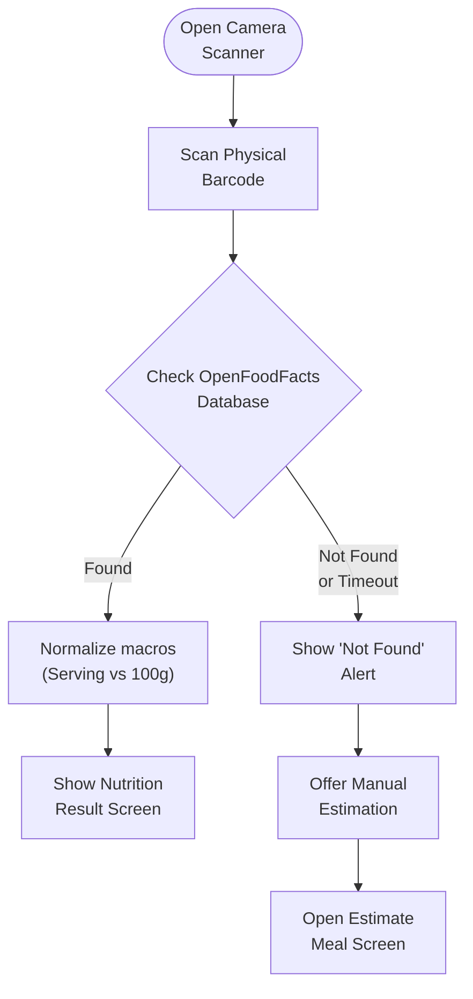

## 12. Clinic & Emergency Locator Flow

The app features a built-in locator to help patients quickly find cardiovascular centers and emergency rooms near them.

### Scenario
**"A patient feels severe palpitations while traveling in a new city and needs to find the nearest cardiologist."**

The patient opens the "Emergency locator" screen. The app pulls their GPS location and displays a list of nearby clinics, sorted exactly by how close they are. Emergency hospitals are badged "24/7", while regular clinics show if they are currently open. The patient taps "Directions" on the nearest one.

### Logic Used
*   **Haversine Distance Calculation:** The app pulls the user's live coordinates (latitude/longitude) and mathematically calculates the exact distance (in km) to every clinic in the database.
*   **Smart Sorting & Status:** Clinics are dynamically sorted from closest to farthest. The app checks the current local time against the clinic's operating hours to label it "Open now" or "Closed" (ignoring 24/7 emergency rooms).
*   **Native OS Linking:** Tapping "Directions" sends a specialized link (`http://maps.apple.com/` for iOS, `google.navigation:` for Android) that instantly opens the phone's native map app with the route pre-loaded. Tapping "Call" opens the native phone dialer.

### 12.1 Clinic Locator Flow

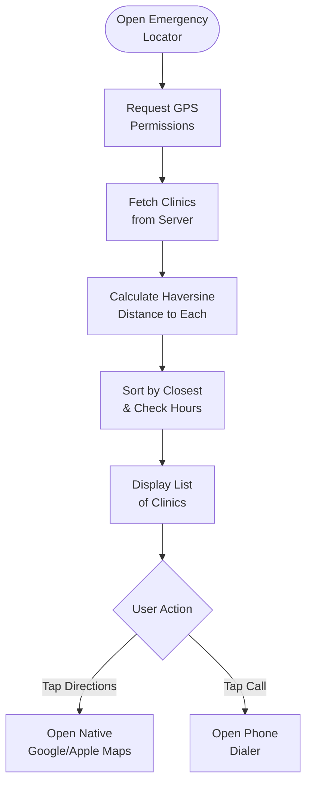

## 13. Visit Summary (for a Doctor or Clinic)

The Visit summary is the one report a patient shows or sends to a doctor or clinic. It replaced the old Consultation Summary and the separate health report (2026-11-12).

### Scenario
**"A patient has a checkup next week and wants to bring their home blood pressure readings."**

From the Dashboard (Care & Support) or Profile, the patient opens the Visit summary. A card says "Readings on 4 of the last 7 days" and suggests checking blood pressure every morning and evening before the visit. On the day, they look at "What your doctor will see first" and "Things to mention to your doctor", tap "Preview the PDF" to check it, then "Share PDF" to send it to the clinic.

### Logic Used
*   **Periods:** The last 7 days are free. 1 month and 3 months are Premium (on a free account they show a lock, and choosing one shows a Premium prompt).
*   **Is Your Summary Ready?:** Counts the days in the last 7 with a blood pressure reading, and the mornings (5–11 am) and evenings (5–10 pm). Doctors look for at least 3 days, and a full week is best (ESH 2021 home blood pressure guidance). It suggests 2 readings a minute apart, morning and evening (AMA/AHA Target: BP).
*   **What the Doctor Sees First:** The blood pressure average, how many readings were at or above 130/80, morning vs evening, medicine taken, heart risk and days logged.
*   **Things to Mention:** High (stage 2), very high or low readings and symptoms, with their date and time, plus health alerts. Newest first.
*   **The PDF:** Follows the AMA/AHA Target: BP home blood pressure log.
    *   *Page 1:* the patient's name, age, sex and health answers; a blood pressure table (averages, the ESH average without the first day, at or above 130/80, highest and lowest with time, pulse); a chart with lines at 130 and 80; things to look at; and medicine, habits and risk.
    *   *Page 2 onwards:* a day-by-day log of every check-in (time, blood pressure, level, pulse, medicine, symptoms), with that day's meals and sodium, exercise and sleep under each day.
*   **Sharing:** The PDF is made with `expo-print`, copied into the app's own cache folder, then shared with `expo-sharing`. Copying it first fixed the Android error "Not allowed to read file under given URL".
*   **Not a Diagnosis:** The summary only lists what was logged, and says so on every page.

### 13.1 Visit Summary Flow

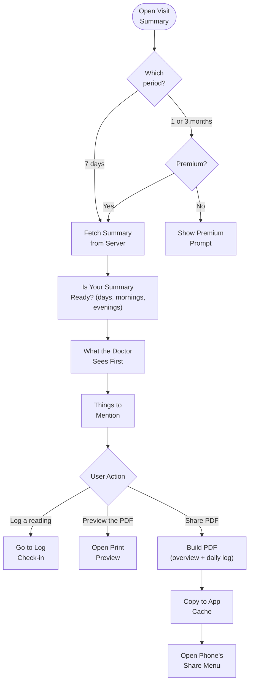

## 14. Case Review & Model Check (Web Portal)

Clinicians check the app's Heart risk on anonymized patients. The full steps for admins and experts are in
`documentation/CASE_REVIEW_GUIDE.md`.

### Scenario
**"A patient's estimated Heart risk is High, so an urgent case opens, and the Cardiologist reviews it the next morning."**

The admin opens Case review and sees the urgent case. The Cardiologist opens it, reads the anonymized snapshot (age,
sex, answers, labs, the last 30 days of readings), and picks the band they would give: Intermediate, with an estimate of
8%. Only after submitting do they see the app's answer (High, 11%, estimated) and "App too high". The Dietitian and the
Physical Therapist then check the recipes and exercises the app gives this patient. Model Check counts the review once
the Cardiologist is a verified clinician.

### Logic Used
*   **Cases open by themselves** when someone opens Case review:
    *   *Urgent:* a High Heart risk, a reading of 180/120 or more or under 90/60, chest discomfort rated 7 or more,
        breathlessness at rest, or fainting.
    *   *Re-review:* the Heart risk band changed since the last review.
    *   *Sample:* an admin draws it weekly, 5 patients per band.
*   **Blind review:** the app's Heart risk stays hidden until the Cardiologist submits.
*   **Model Check:** agreement, weighted kappa, and under- and over-calling between the app's band and the Cardiologist's.
    It counts verified clinicians only, needs 30 reviews before the numbers mean anything, and can be filtered to the
    machine learning "Estimated" risk.
*   **No patient effect:** reviews don't change what patients see. Retraining from reviews is switched off.

### 14.1 Case Review Flow

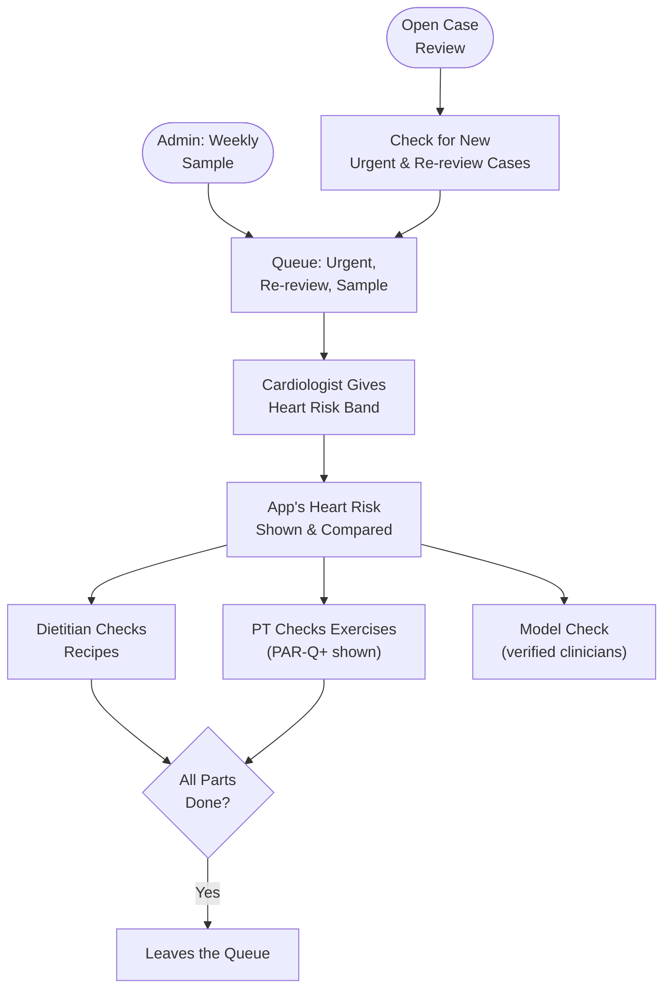
